# Bug Reports: Agileway Travel

**URL:** https://travel.agileway.net/login  
**Browser / OS:** Chrome, macOS  
**Date tested:** 2026-11-02

## Summary

| Severity | Count |
|----------|-------|
| Critical | 7 |
| High | 4 |
| Medium | 3 |
| **Total** | **14** |

## Bug List

| ID | Bug Title | Severity |
|----|-----------|----------|
| BUG-001 | Select Flight → Origin and Destination are not required | Critical |
| BUG-002 | Select Flight → Same origin and destination are accepted | High |
| BUG-003 | Select Flight → Return date before departure date is accepted | Critical |
| BUG-004 | Select Flight → All flights are pre-checked and multiple flights can be selected | Medium |
| BUG-005 | Select Flight → Continue is accepted with no flight selected | High |
| BUG-006 | Passenger Details → First name is not validated | Critical |
| BUG-007 | Passenger Details → Last name accepts numbers and special characters | High |
| BUG-008 | Pay by Credit Card → Card type is not required | Critical |
| BUG-009 | Pay by Credit Card → Card holder's name is not required | High |
| BUG-010 | Pay by Credit Card → Card number is not required | Critical |
| BUG-011 | Pay by Credit Card → Expired card (01/2026) is accepted | Critical |
| BUG-012 | Pay by Credit Card → Expiry year list stops at 2029 | Medium |
| BUG-013 | Passenger Details and Confirmation → Flight number, time, and airline are not displayed | Medium |
| BUG-014 | Register → Page has no registration form | Critical |

---

## BUG-001: Select Flight → Origin and Destination are not required

| Severity | Type | Status |
|----------|------|--------|
| Critical | Functional | Open |

**Steps to Reproduce**
1. Open "Select Flight".
2. Leave "From" as "Origin" and "To" as "Destination".
3. Click Continue and finish the booking.

**Actual Result:**  
The booking continues without choosing origin or destination.  
The fare shows "Fare (return to ):" and the flight summary shows "2026-01-01 to" with nothing after "to".

**Expected Result:**  
Origin and Destination must be required. The user should not continue until both are selected.

**Evidence:** 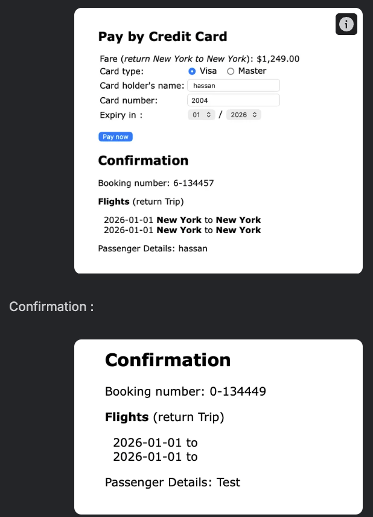

---

## BUG-002: Select Flight → Same origin and destination are accepted

| Severity | Type | Status |
|----------|------|--------|
| High | Functional | Open |

**Steps to Reproduce**
1. Open "Select Flight".
2. Select "New York" in both "From" and "To".
3. Click Continue and finish the booking.

**Actual Result:**  
The system accepts a flight from New York to New York and confirms the booking.

**Expected Result:**  
Origin and destination must be different cities. If they are the same, an error message should appear.

**Evidence:** 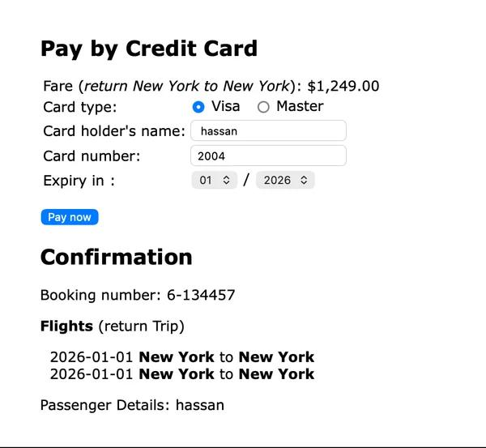

---

## BUG-003: Select Flight → Return date before departure date is accepted

| Severity | Type | Status |
|----------|------|--------|
| Critical | Functional | Open |

**Steps to Reproduce**
1. Open "Select Flight" and choose "Return".
2. Set Departing to 01 February 2026 and Returning to 01 January 2026.
3. Click Continue and finish the booking.

**Actual Result:**  
The system accepts a return date that is before the departure date. The booking is confirmed.

**Expected Result:**  
The return date must be on or after the departure date. If not, an error message should appear.

**Evidence:** 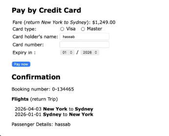

---

## BUG-004: Select Flight → All flights are pre-checked and multiple flights can be selected

| Severity | Type | Status |
|----------|------|--------|
| Medium | Functional / UI | Open |

**Steps to Reproduce**
1. Open "Select Flight", choose New York → Sydney (Return), and click Continue.
2. Look at the flight list (QF821, VA23, QF983).
3. Click Continue without changing anything.

**Actual Result:**  
All three flights are shown as checkboxes and are already checked. The system accepts this and continues.

**Expected Result:**  
Only one flight should be selectable (like radio buttons). No flight should be selected by default.

**Evidence:** 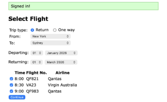

---

## BUG-005: Select Flight → Continue is accepted with no flight selected

| Severity | Type | Status |
|----------|------|--------|
| High | Functional | Open |

**Steps to Reproduce**
1. Open "Select Flight" and click Continue to reach the flight list.
2. Make sure no flight is selected (QF821, VA23, QF983).
3. Click Continue.

**Actual Result:**  
The system goes to the next step and the booking is completed without any flight selected.

**Expected Result:**  
The user must select a flight before continuing. The Continue button should be disabled, or an error message should appear.

**Evidence:** 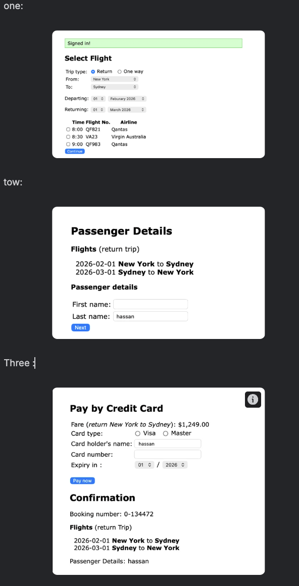

---

## BUG-006: Passenger Details → First name is not validated

| Severity | Type | Status |
|----------|------|--------|
| Critical | Functional | Open |

**Steps to Reproduce**
1. Go to "Passenger Details".
2. Leave "First name" empty and fill "Last name".
3. Click Next.

**Actual Result:**  
The system accepts an empty first name and completes the booking. The confirmation page shows only the last name.

**Expected Result:**  
First name must be required. An error message should appear and the user should not continue.

**Evidence:** 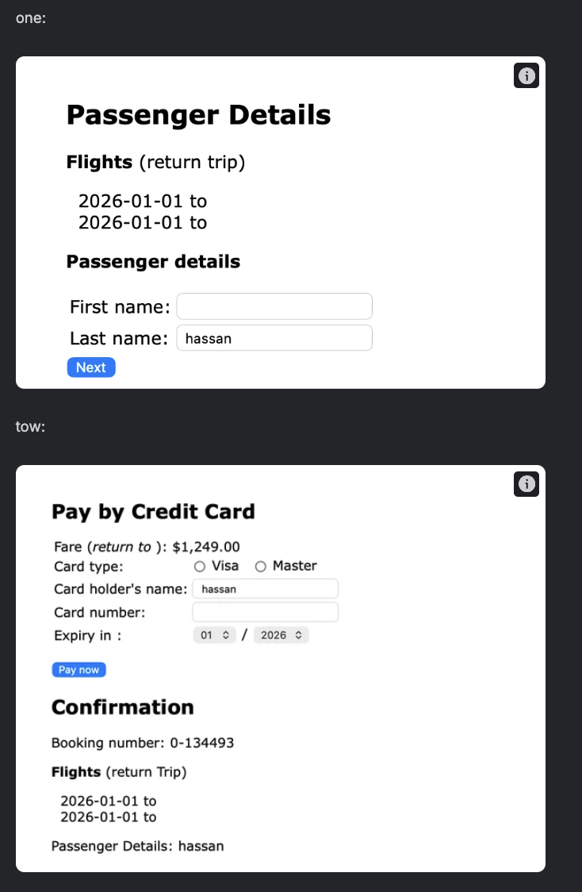

---

## BUG-007: Passenger Details → Last name accepts numbers and special characters

| Severity | Type | Status |
|----------|------|--------|
| High | Functional | Open |

**Steps to Reproduce**
1. Go to "Passenger Details".
2. Enter something like "test٣٤٣٤٨٤@" in "Last name".
3. Click Next.

**Actual Result:**  
The value is accepted and shown on the confirmation page.

**Expected Result:**  
Name fields should accept letters only.

**Evidence:** 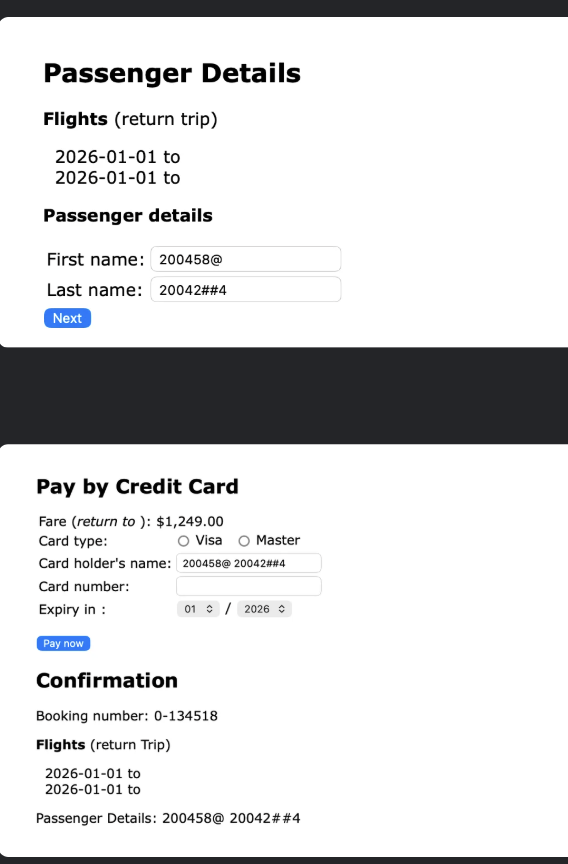

---

## BUG-008: Pay by Credit Card → Card type is not required

| Severity | Type | Status |
|----------|------|--------|
| Critical | Functional | Open |

**Steps to Reproduce**
1. Go to "Pay by Credit Card".
2. Do not select Visa or Master.
3. Fill the other fields and click "Pay now".

**Actual Result:**  
The payment is accepted and a booking number is created.

**Expected Result:**  
Card type must be required. An error message should appear if none is selected.

**Evidence:** 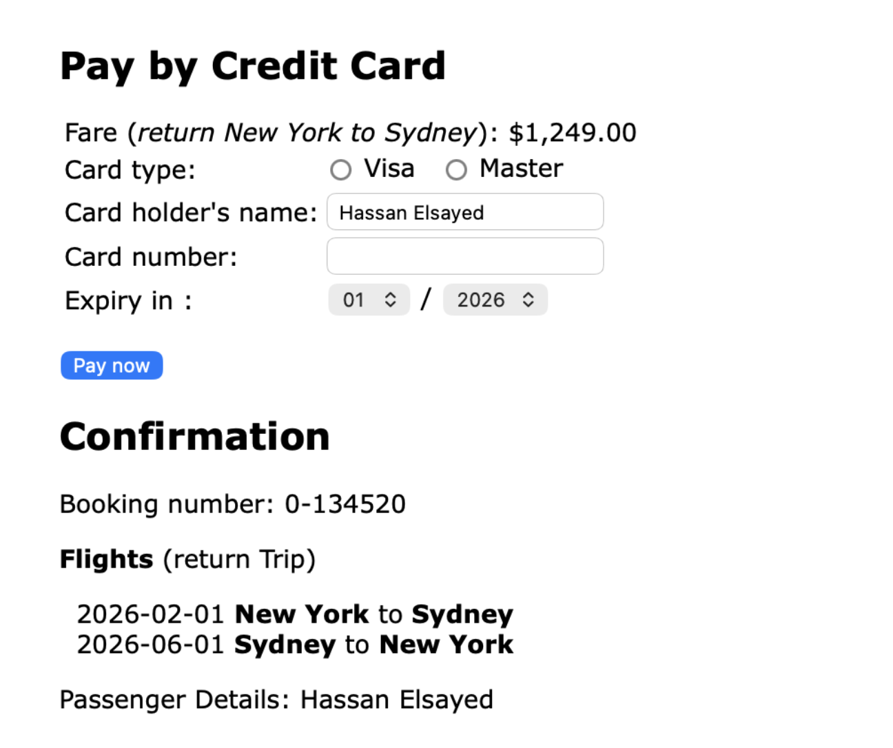

---

## BUG-009: Pay by Credit Card → Card holder's name is not required

| Severity | Type | Status |
|----------|------|--------|
| High | Functional | Open |

**Steps to Reproduce**
1. Go to "Pay by Credit Card".
2. Select a card type and leave "Card holder's name" empty.
3. Click "Pay now".

**Actual Result:**  
The payment is accepted and a booking number is created.  
(Note: This field is auto-filled from First Name + Last Name, but the system still allows payment when it is empty.)

**Expected Result:**  
Card holder's name must be required. An error message should appear and the payment should not go through.

**Evidence:** 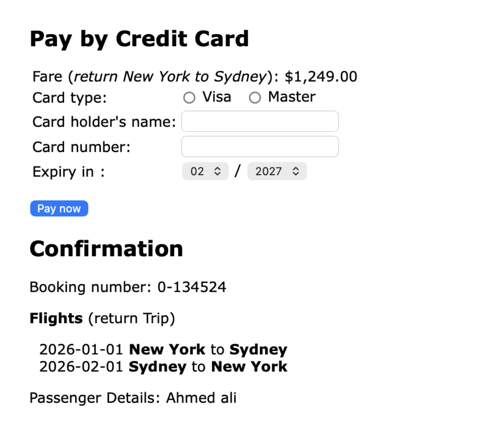

---

## BUG-010: Pay by Credit Card → Card number is not required

| Severity | Type | Status |
|----------|------|--------|
| Critical | Functional | Open |

**Steps to Reproduce**
1. Go to "Pay by Credit Card".
2. Leave "Card number" empty.
3. Click "Pay now".

**Actual Result:**  
The payment is accepted and a booking number is created without any card number.

**Expected Result:**  
Card number must be required. An error message should appear and the payment should not go through.

**Evidence:** 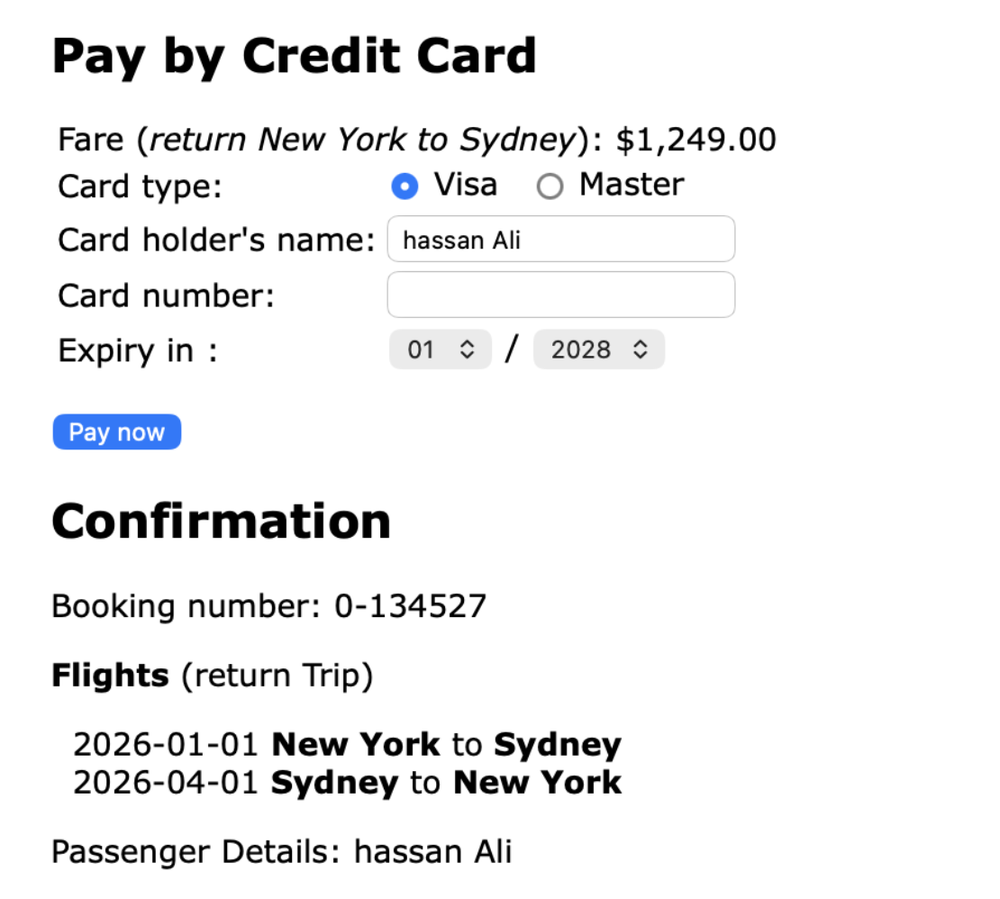

---

## BUG-011: Pay by Credit Card → Expired card (01/2026) is accepted

| Severity | Type | Status |
|----------|------|--------|
| Critical | Functional | Open |

**Steps to Reproduce**
1. Go to "Pay by Credit Card" (today is 2 November 2026).
2. Keep the expiry date as 01 / 2026.
3. Click "Pay now".

**Actual Result:**  
The payment succeeds even though the card has already expired.

**Expected Result:**  
An expired card should be rejected. An error message should appear.

**Evidence:** 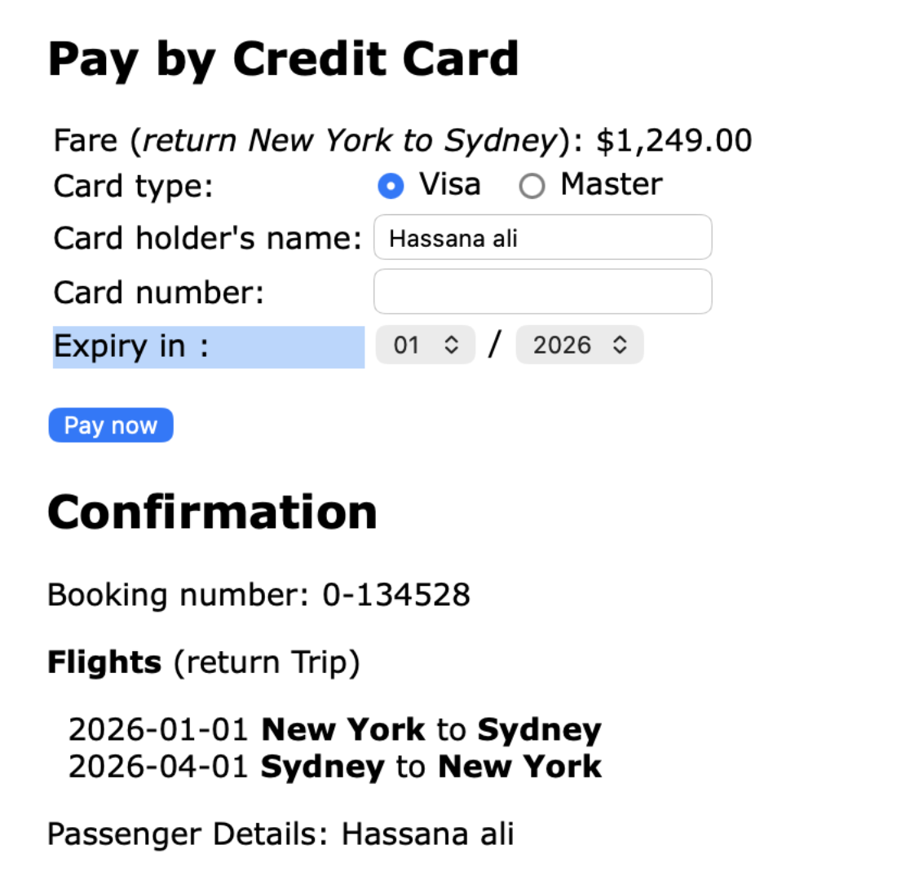

---

## BUG-012: Pay by Credit Card → Expiry year list stops at 2029

| Severity | Type | Status |
|----------|------|--------|
| Medium | Functional | Open |

**Steps to Reproduce**
1. Go to "Pay by Credit Card".
2. Open the expiry year dropdown and look for years after 2029.

**Actual Result:**  
The last year in the list is 2029. You cannot choose 2030 or later.

**Expected Result:**  
The list should include more future years (for example the next 10 years).

**Evidence:** 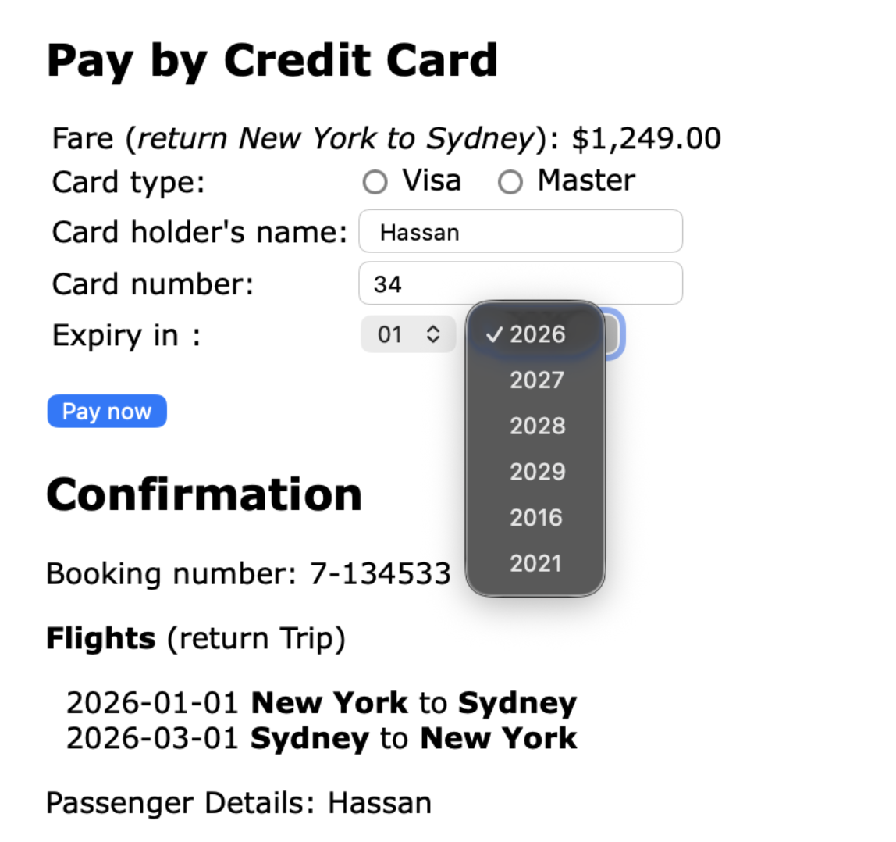

---

## BUG-013: Passenger Details and Confirmation → Flight number, time, and airline are not displayed

| Severity | Type | Status |
|----------|------|--------|
| Medium | Functional | Open |

**Steps to Reproduce**
1. Select a flight (for example Sydney → New York).
2. Go to "Passenger Details" and check the "Flights" section.
3. Complete the booking and check the "Confirmation" page.

**Actual Result:**  
Both pages only show the dates and cities.  
The flight number, time, and airline are missing.

**Expected Result:**  
The selected flight details (flight number, time, and airline) should be shown.

**Evidence:** 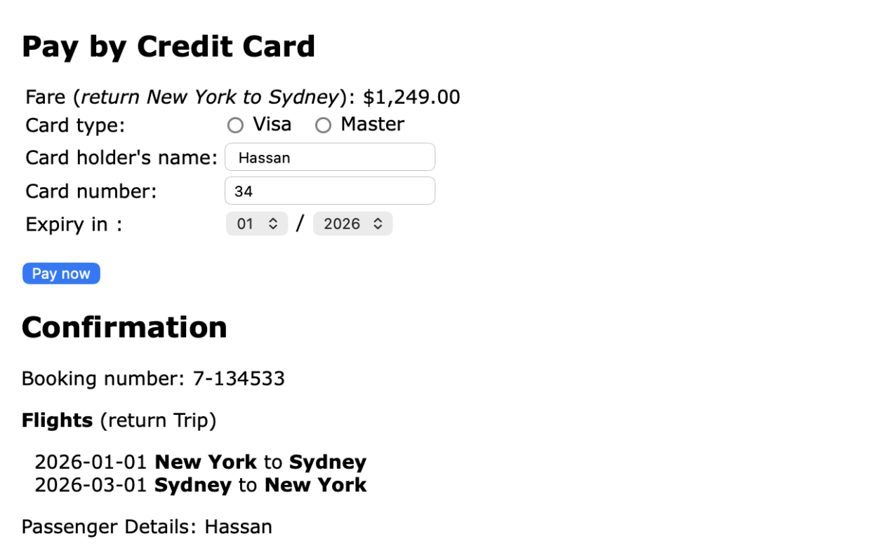

---

## BUG-014: Register → Page has no registration form

| Severity | Type | Status |
|----------|------|--------|
| Critical | Functional | Open |

**Steps to Reproduce**
1. Open https://travel.agileway.net/login.
2. Click the "Register" link.

**Actual Result:**  
The page opens with the title "New Staff" and only a "Terms and Conditions" link.  
There is no form to create an account.

**Expected Result:**  
There should be a registration form (name, username, password, etc.) with a submit button.

**Evidence:** 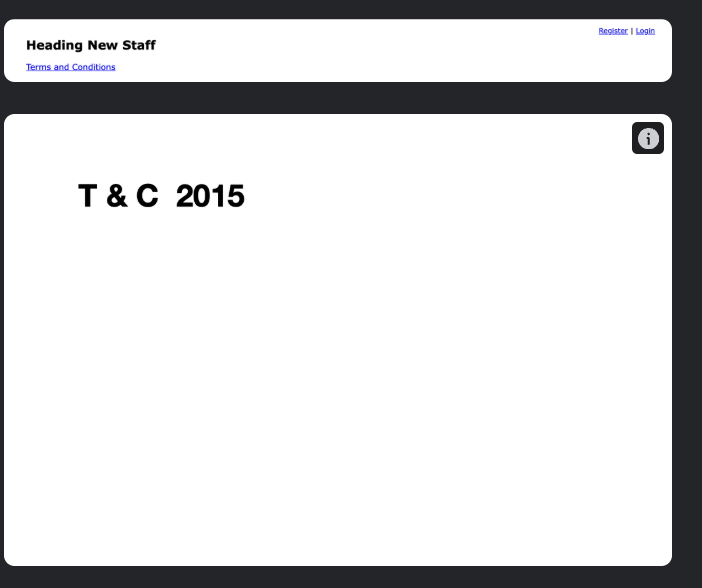
