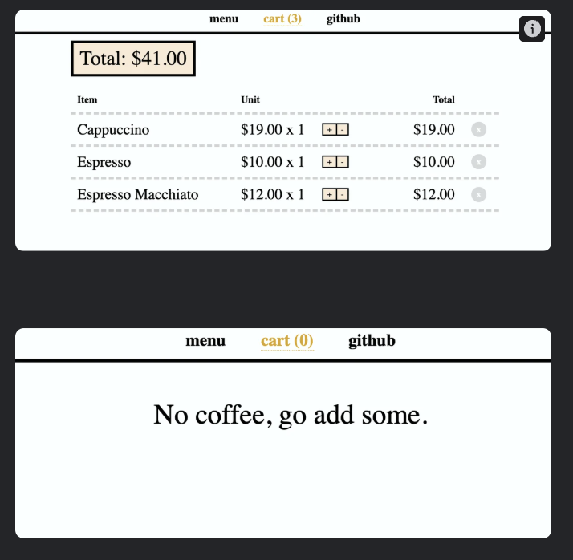
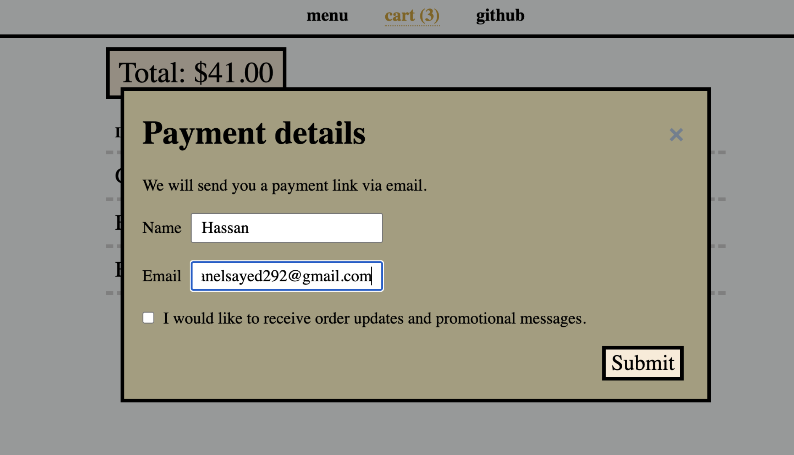
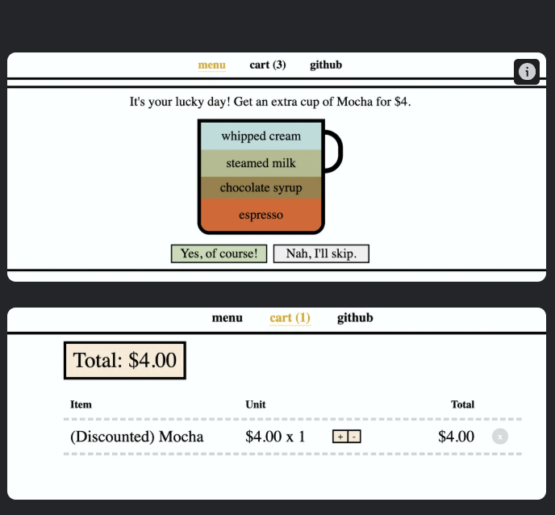

# Bug Reports: Coffee Cart

**URL:** https://coffee-cart.app/  
**Browser / OS:** Chrome, macOS  
**Date tested:** 2026-11-06

## Summary

| Severity | Count |
|----------|-------|
| High | 2 |
| Medium | 1 |
| **Total** | **3** |

## Bug List

| ID | Bug Title | Severity |
|----|-----------|----------|
| BUG-001 | Cart → Cart items are removed after reloading the page | Medium |
| BUG-002 | Payment details → Thank-you message is shown but no payment link is received by email | High |
| BUG-003 | Discounted Mocha → Discount stays after the qualifying items are removed | High |

---

## BUG-001: Cart → Cart items are removed after reloading the page

| Severity | Type | Status |
|----------|------|--------|
| Medium | Functional | Open |

**Steps to Reproduce**
1. Open the Coffee Cart website.
2. Add some items to the cart (for example Cappuccino, Espresso, Espresso Macchiato).
3. Open the cart page and check the items.
4. Reload the page.

**Actual Result:**  
All items are removed from the cart after reloading the page.

**Expected Result:**  
The cart items should stay in the cart after reloading the page (the site has no login, so they should be kept in the browser).

**Evidence:**

  

---

## BUG-002: Payment details → Thank-you message is shown but no payment link is received by email

| Severity | Type | Status |
|----------|------|--------|
| High | Functional | Open |

**Steps to Reproduce**
1. Add items to the cart and open the cart page.
2. Click the "Total" box to open "Payment details".
3. Enter a name and a valid email address, then click Submit.
4. Check the inbox and the spam folder of that email.

**Actual Result:**  
A thank-you message is shown, but no payment link (or any email) is received at the entered email address.

**Expected Result:**  
A payment link should be sent to the entered email address, as the form says: "We will send you a payment link via email."

**Evidence:**

  

---

## BUG-003: Discounted Mocha → Discount stays after the qualifying items are removed

| Severity | Type | Status |
|----------|------|--------|
| High | Functional | Open |

**Steps to Reproduce**
1. Add 3 items to the cart (Cappuccino, Espresso, Espresso Macchiato).
2. Accept the Mocha offer by clicking "Yes, of course!".
3. Open the cart and remove the three original items (click "x" on each one).

**Actual Result:**  
The "(Discounted) Mocha" stays in the cart at $4.00 (cart (1), total $4.00), even though the 3 qualifying items were removed.

**Expected Result:**  
The discounted Mocha should be removed (or charged at the regular price) when the qualifying items are no longer in the cart.

**Evidence:**

  
