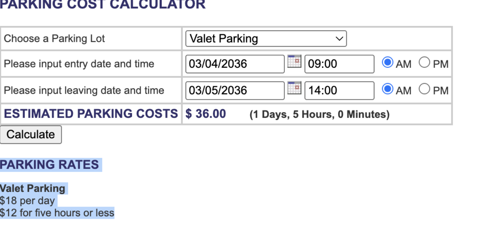
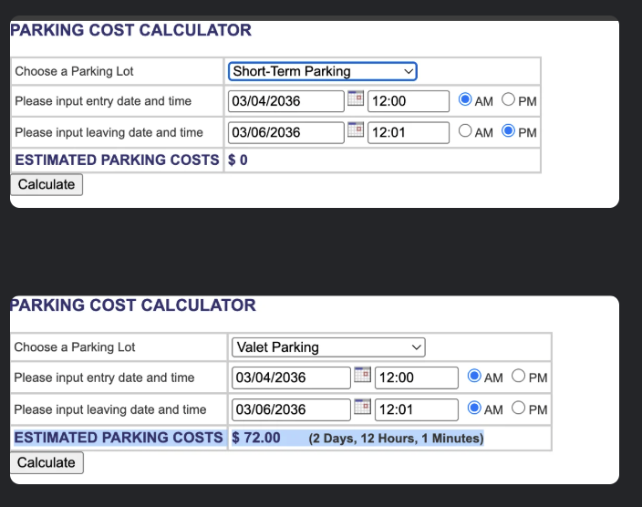
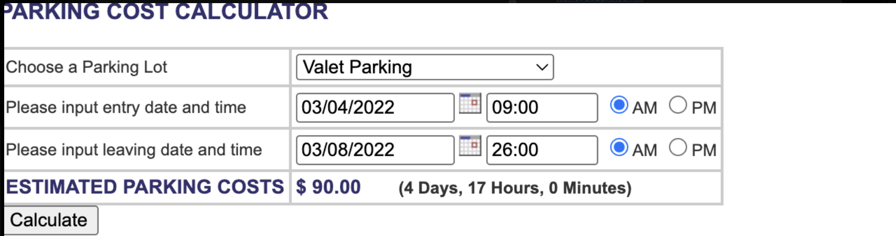

# Bug Reports: Parking Cost Calculator

**URL:** https://www.shino.de/parkcalc/  
**Browser / OS:** Chrome, macOS  
**Date tested:** 2026-11-09

## Summary

| Severity | Count |
|----------|-------|
| High | 1 |
| Medium | 2 |
| Low | 1 |
| **Total** | **4** |

## Bug List

| ID | Bug Title | Severity |
|----|-----------|----------|
| BUG-001 | Valet Parking → Fare for 1 day and 5 hours is $36.00 instead of $30.00 | High |
| BUG-002 | Calculate → Parking lot and AM/PM selections are reset after calculating | Medium |
| BUG-003 | Time fields → Invalid times are accepted | Medium |
| BUG-004 | UI → Page has no margins and a plain layout (all content is stuck to the left edge) | Low |

---

## BUG-001: Valet Parking → Fare for 1 day and 5 hours is $36.00 instead of $30.00

| Severity | Type | Status |
|----------|------|--------|
| High | Functional | Open |

**Steps to Reproduce**
1. Open https://www.shino.de/parkcalc/ and choose "Valet Parking".
2. Enter entry date 03/04/2036 at 09:00 AM.
3. Enter leaving date 03/05/2036 at 14:00 and keep AM selected.
4. Click Calculate.

**Actual Result:**  
The estimated cost is $36.00 (1 Days, 5 Hours, 0 Minutes).

**Expected Result:**  
According to the rates on the page (Valet Parking: $18 per day, $12 for five hours or less), the cost should be $30.00 ($18 for the day + $12 for the 5 hours).

**Evidence:**

---

## BUG-002: Calculate → Parking lot and AM/PM selections are reset after calculating

| Severity | Type | Status |
|----------|------|--------|
| Medium | Functional / UI | Open |

**Steps to Reproduce**
1. Open https://www.shino.de/parkcalc/.
2. Choose "Short-Term Parking" as the parking lot.
3. Enter entry date 03/04/2036 at 12:00 AM and leaving date 03/06/2036 at 12:01 PM.
4. Click Calculate.

**Actual Result:**  
The result is shown ($72.00, 2 Days, 12 Hours, 1 Minutes), but the form is reset: the parking lot changes back to "Valet Parking" and the leaving time changes from PM to AM. The "12 Hours" in the result shows that PM was used before the reset.

**Expected Result:**  
The form should keep the selected values after calculating, so the result matches what is shown on the screen.

**Evidence:**

  

---

## BUG-003: Time fields → Invalid times are accepted

| Severity | Type | Status |
|----------|------|--------|
| Medium | Functional | Open |

**Steps to Reproduce**
1. Open https://www.shino.de/parkcalc/ and choose "Valet Parking".
2. Enter entry date 03/04/2022 at 09:00 AM.
3. Enter leaving date 03/08/2022 at 26:00 and keep AM selected.
4. Click Calculate.

**Actual Result:**  
The site accepts "26:00" and shows $90.00 (4 Days, 17 Hours, 0 Minutes). No error message appears. The same happens with "14:00 AM".

**Expected Result:**  
The time should be from 01:00 to 12:59 with AM/PM. Invalid times like "26:00" should be rejected with an error message.

**Evidence:**

  

---

## BUG-004: UI → Page has no margins and a plain layout (all content is stuck to the left edge)

| Severity | Type | Status |
|----------|------|--------|
| Low | UI (Suggestion) | Open |

**Steps to Reproduce**
1. Open https://www.shino.de/parkcalc/.
2. Look at the page layout.

**Actual Result:**  
The title, the table, and the rates text are stuck to the left edge of the page with no margin or spacing. The page looks plain and the rates are shown as plain text lines.

**Expected Result:**  
The content should have margins and spacing and a clear layout (for example centered, with a clear section for the rates).
