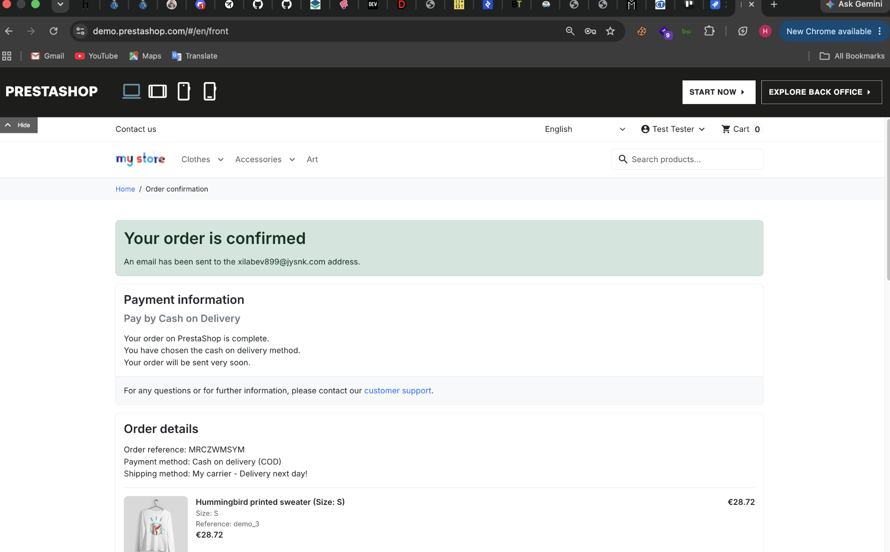
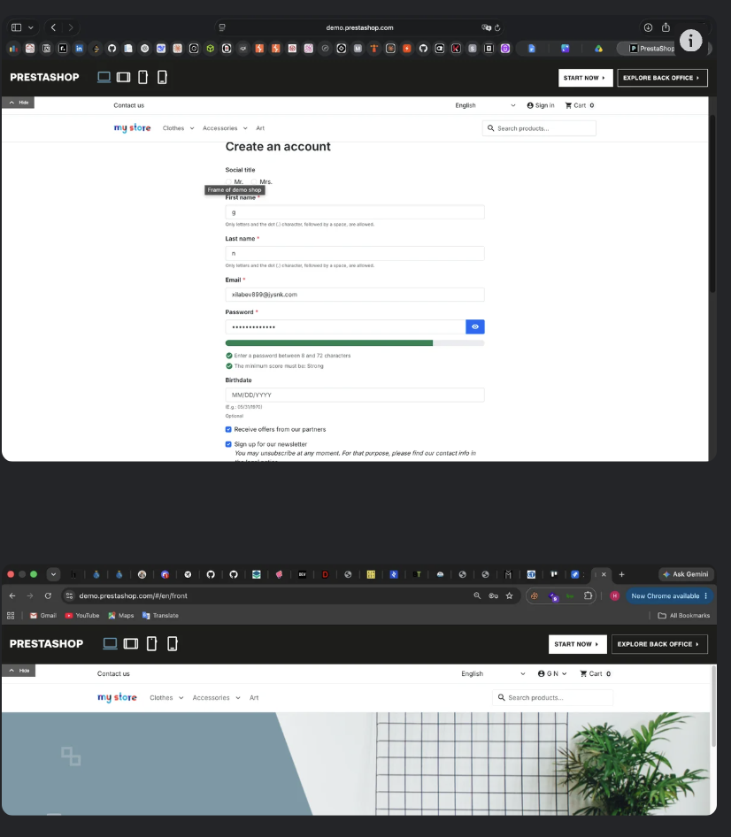

# Bug Reports: PrestaShop Live Demo

**URL:** https://demo.prestashop.com/  
**Browser / OS:** Chrome, macOS  
**Date tested:** 2026-11-13

## Summary

| Severity | Count |
|----------|-------|
| Medium | 1 |
| Low | 1 |
| **Total** | **2** |

## Bug List

| ID | Bug Title | Severity |
|----|-----------|----------|
| BUG-001 | Order confirmation → Not receiving any order confirmation email after completing an order | Medium |
| BUG-002 | Create an account → First name and Last name accept only 1 letter | Low |

---

## BUG-001: Order confirmation → Not receiving any order confirmation email after completing an order

| Severity | Type | Status |
|----------|------|--------|
| Medium | Functional | Open |

**Steps to Reproduce**
1. Open https://demo.prestashop.com/ and create an account with your email address.
2. Add a product to the cart and click "Proceed to checkout".
3. Fill in the address, choose the shipping method, and go to Payment.
4. Choose "Pay by Cash on Delivery", agree to the terms of service, and click "Place Order".
5. Read the confirmation page. Then check the inbox and the spam folder of the same email address.

**Actual Result:**  
The confirmation page says: "An email has been sent to xilabev899@jysnk.com address."  
But no message arrives in the inbox or in the spam folder.

**Expected Result:**  
After the order is completed, an email should arrive at the same email address. The email should confirm the order and show the order number and the order details.

**Evidence:**

  

---

## BUG-002: Create an account → First name and Last name accept only 1 letter

| Severity | Type | Status |
|----------|------|--------|
| Low | Functional | Open |

**Steps to Reproduce**
1. Open https://demo.prestashop.com/ and click "Sign in".
2. Click "No account? Create one here".
3. Type "g" in First name and "n" in Last name.
4. Type a valid email and a strong password. Accept the required boxes.
5. Click Save.

**Actual Result:**  
The account is created. The header shows "G N". There is no error message.

**Expected Result:**  
The site should not accept a name with only 1 letter. It should show an error message.

**Evidence:**

  

