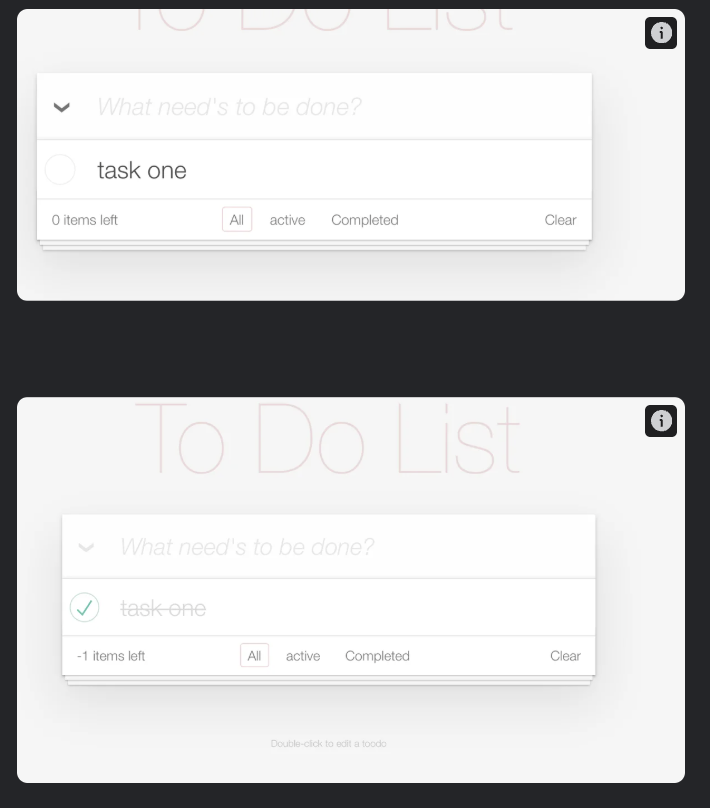
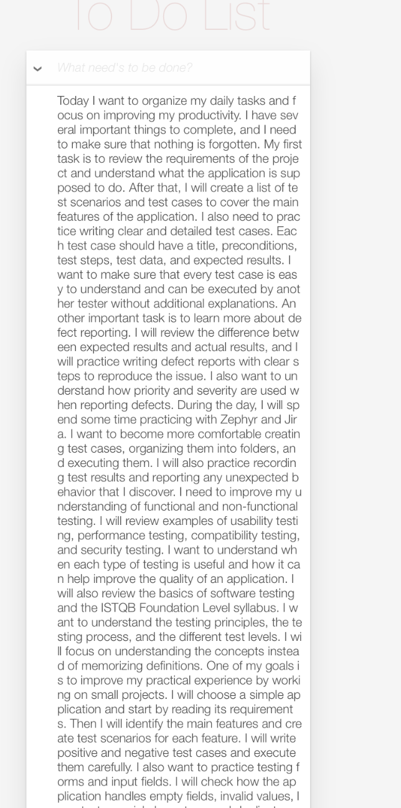
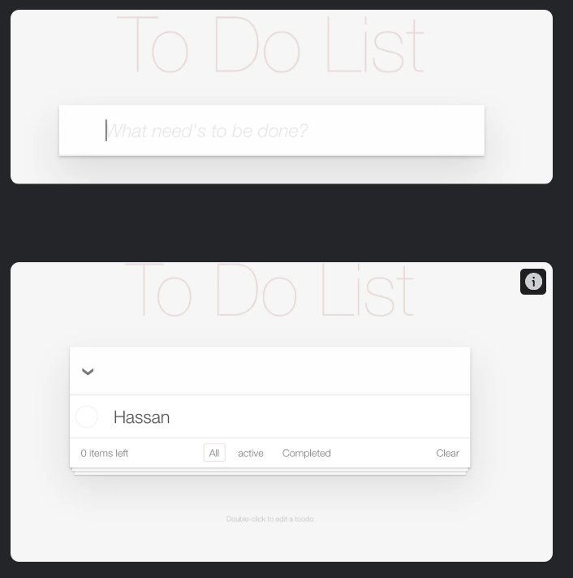

# Bug Reports: To Do List

**URL:** https://todolist.james.am/#/  
**Browser / OS:** Chrome, macOS  
**Date tested:** 2026-11-04

## Summary

| Severity | Count |
|----------|-------|
| Medium | 3 |
| Low | 1 |
| **Total** | **4** |

## Bug List

| ID | Bug Title | Severity |
|----|-----------|----------|
| BUG-001 | Counter → "items left" shows the wrong number (one less than the real count) | Medium |
| BUG-002 | Add task → No maximum length for the task text | Medium |
| BUG-003 | Add task → Placeholder is not displayed again after adding a task | Low |
| BUG-004 | Edit task → Editing by double-click does not work on mobile (page zooms instead) | Medium |

---

## BUG-001: Counter → "items left" shows the wrong number (one less than the real count)

| Severity | Type | Status |
|----------|------|--------|
| Medium | Functional | Open |

**Steps to Reproduce**
1. Open https://todolist.james.am/#/.
2. Add one task (for example "task one").
3. Check the counter at the bottom.
4. Mark the task as completed and check the counter again.

**Actual Result:**  
With one active task, the counter shows "0 items left".  
After marking it as completed, the counter shows "-1 items left".

**Expected Result:**  
The counter should show "1 item left" with one active task, and "0 items left" after completing it. It should never show a negative number.

**Evidence:**

---

## BUG-002: Add task → No maximum length for the task text

| Severity | Type | Status |
|----------|------|--------|
| Medium | Functional / UI | Open |

**Steps to Reproduce**
1. Open https://todolist.james.am/#/.
2. Paste a very long text (more than 1000 words) in "What need's to be done?".
3. Press Enter.

**Actual Result:**  
The whole text is accepted with no limit, even when it is thousands of words long (the screenshot shows only the first part of it). It is shown as a very long block, and the words are split in the middle (for example "f ocus", "sev eral").

**Expected Result:**  
There should be a maximum length for a task. Long text should wrap by whole words.

**Evidence:**

---

## BUG-003: Add task → Placeholder is not displayed again after adding a task

| Severity | Type | Status |
|----------|------|--------|
| Low | UI / UX | Open |

**Steps to Reproduce**
1. Open https://todolist.james.am/#/. The placeholder "What need's to be done?" is displayed.
2. Add a task and press Enter.
3. Look at the empty input field, or click in it to add another task.

**Actual Result:**  
The placeholder is not displayed again after the first task is added.

**Expected Result:**  
The placeholder should be displayed every time the input field is empty.

**Evidence:**

---

## BUG-004: Edit task → Editing by double-click does not work on mobile (page zooms instead)

| Severity | Type | Status |
|----------|------|--------|
| Medium | Functional / Mobile | Open |

**Steps to Reproduce**
1. Open https://todolist.james.am/#/ on a mobile phone (Chrome).
2. Add a task.
3. Double-tap on the task text to edit it.

**Actual Result:**  
The page zooms in instead of opening the edit mode. The only way mentioned in the page to edit a task is "Double-click to edit a toodo".

**Expected Result:**  
The user should be able to edit a task on mobile (for example with a long press or an edit button), and the page should not zoom.

