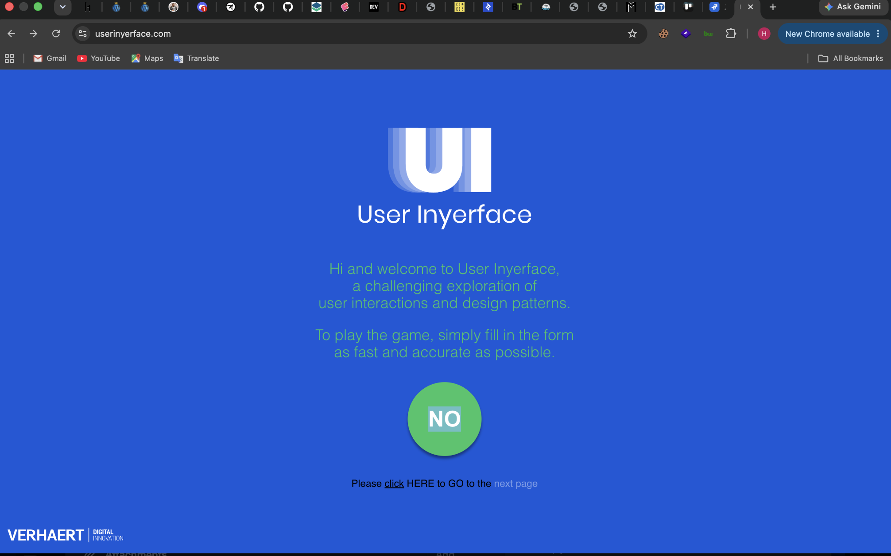
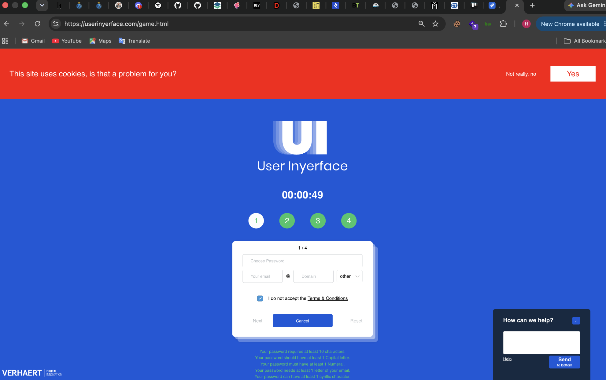
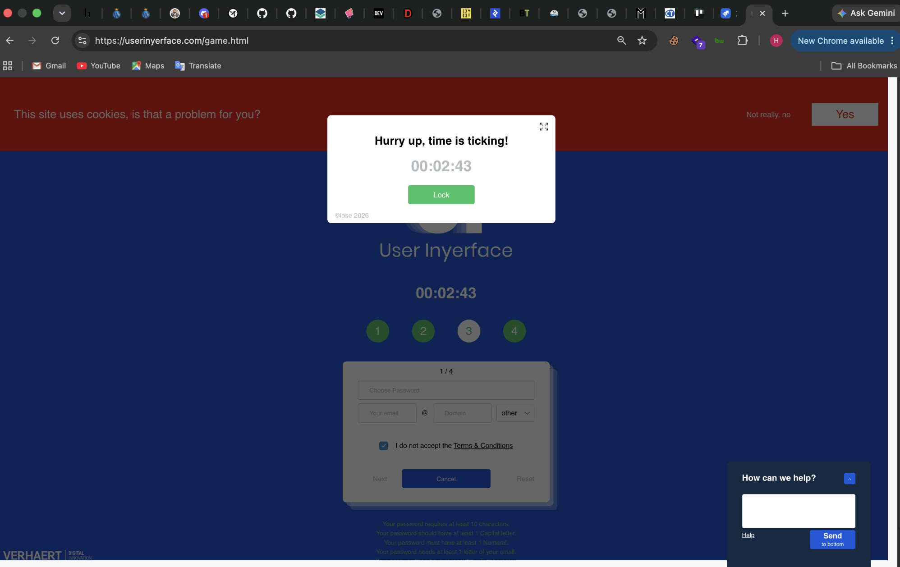
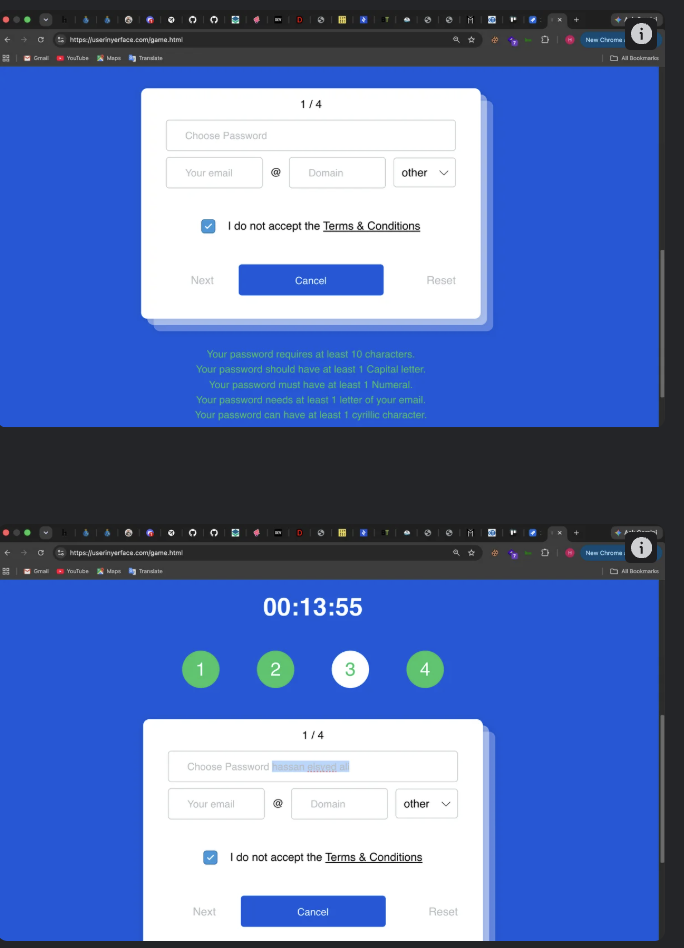
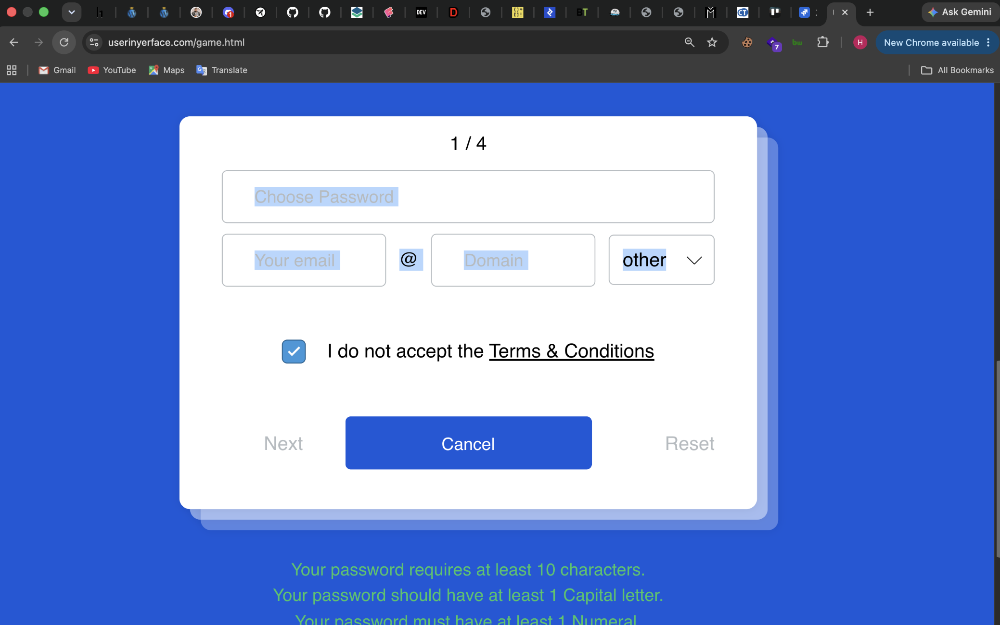
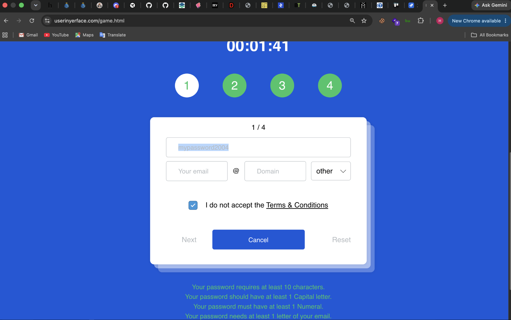
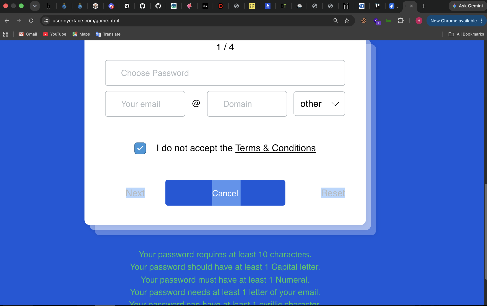

# Bug Reports: User Inyerface

**URL:** https://userinyerface.com/  
**Browser / OS:** Chrome, macOS  
**Date tested:** 2026-11-14

**Note:** This website is made with bad UX on purpose. The issues below are UI/UX issues, not code errors.

## Summary

| Severity | Count |
|----------|-------|
| High | 1 |
| Medium | 1 |
| Low | 6 |
| **Total** | **8** |

## Bug List

| ID | Bug Title | Severity |
|----|-----------|----------|
| BUG-001 | Home page → "NO" button is green instead of red | Low |
| BUG-002 | Home page → The word "click" is underlined, but only "HERE" is a link | Low |
| BUG-003 | Cookie banner → The question "is that a problem for you?" is confusing | Low |
| BUG-004 | Timer popup → There is no clear "Close" button | Medium |
| BUG-005 | Sign-up form → Placeholder text stays in the Password and Email fields when typing | Low |
| BUG-006 | Sign-up form → Password field is above the Email field | Low |
| BUG-007 | Sign-up form → Password is shown as plain text while typing | High |
| BUG-008 | Sign-up form → "Cancel" looks like the main button, but "Next" and "Reset" look like plain gray text | Low |

---

## BUG-001: Home page → "NO" button is green instead of red

| Severity | Type | Status |
|----------|------|--------|
| Low | UI | Open |

**Steps to Reproduce**
1. Open https://userinyerface.com/.
2. Look at the "NO" button under the welcome text.

**Actual Result:**  
The "NO" button is green.

**Expected Result:**  
A "NO" button should be red (or a neutral color). Green usually means "yes".

**Evidence:**

---

## BUG-002: Home page → The word "click" is underlined, but only "HERE" is a link

| Severity | Type | Status |
|----------|------|--------|
| Low | UI | Open |

**Steps to Reproduce**
1. Open https://userinyerface.com/.
2. Look at the sentence "Please click HERE to GO to the next page".
3. Click the word "click".
4. Click the word "HERE".

**Actual Result:**  
The word "click" is underlined, but nothing happens when you click it.  
The word "HERE" is the real link and opens the next page (game.html), but it is not underlined.

**Expected Result:**  
The underline should be under "HERE", because it is the link.

**Evidence:**

---

## BUG-003: Cookie banner → The question "is that a problem for you?" is confusing

| Severity | Type | Status |
|----------|------|--------|
| Low | UI | Open |

**Steps to Reproduce**
1. Open https://userinyerface.com/ and click "HERE" to open the game page (game.html).
2. Look at the red cookie banner at the top of the page.

**Actual Result:**  
The banner says: "This site uses cookies, is that a problem for you?" with two options: "Yes" and "Not really, no".  
The question is negative. "Yes" means the user has a problem, so it is easy to choose the wrong answer.

**Expected Result:**  
A clear question, for example "This site uses cookies. Do you accept?", with "Accept" and "Reject" buttons.

**Evidence:**

---

## BUG-004: Timer popup → There is no clear "Close" button

| Severity | Type | Status |
|----------|------|--------|
| Medium | UI | Open |

**Steps to Reproduce**
1. Open the game page (https://userinyerface.com/game.html).
2. Wait until the popup "Hurry up, time is ticking!" appears.
3. Look for a way to close the popup.

**Actual Result:**  
The popup has no Close button.  
At the bottom left there is the text "©lose 2026", which looks like copyright text, not a button.  
The icon at the top right looks like an expand icon, not an X.

**Expected Result:**  
The popup should have a clear and visible "Close" button (or an X).

**Evidence:**

---

## BUG-005: Sign-up form → Placeholder text stays in the Password and Email fields when typing

| Severity | Type | Status |
|----------|------|--------|
| Low | UI | Open |

**Steps to Reproduce**
1. Open https://userinyerface.com/ and click "HERE" to open the game page (game.html).
2. In the first form, click the "Choose Password" field and type "hassan elsyed ali".
3. Click the "Your email" field and type any text.

**Actual Result:**  
The text "Choose Password" does not disappear. The typed text is added after it.  
The same happens in the "Your email" field.

**Expected Result:**  
The placeholder text should disappear when the user starts typing. Only the typed text should stay in the field.

**Evidence:**

  

---

## BUG-006: Sign-up form → Password field is above the Email field

| Severity | Type | Status |
|----------|------|--------|
| Low | UI (Suggestion) | Open |

**Steps to Reproduce**
1. Open https://userinyerface.com/ and click "HERE" to open the game page (game.html).
2. Look at the order of the fields in the first form.

**Actual Result:**  
The "Choose Password" field is first, and the email fields ("Your email", "Domain") are below it.

**Expected Result:**  
The Email field should be above the Password field, which is the normal order in sign-up forms.

**Evidence:**

---

## BUG-007: Sign-up form → Password is shown as plain text while typing

| Severity | Type | Status |
|----------|------|--------|
| High | UI / Security | Open |

**Steps to Reproduce**
1. Open https://userinyerface.com/ and click "HERE" to open the game page (game.html).
2. Click the "Choose Password" field.
3. Type "mypassword2004".

**Actual Result:**  
The password is shown as plain text. The characters are not changed to dots or stars.

**Expected Result:**  
The password characters should be hidden (dots or stars) while the user types.

**Evidence:**

---

## BUG-008: Sign-up form → "Cancel" looks like the main button, but "Next" and "Reset" look like plain gray text

| Severity | Type | Status |
|----------|------|--------|
| Low | UI | Open |

**Steps to Reproduce**
1. Open https://userinyerface.com/ and click "HERE" to open the game page (game.html).
2. Look at the three buttons at the bottom of the first form: "Next", "Cancel", and "Reset".

**Actual Result:**  
"Cancel" is a solid blue button and is the most noticeable.  
"Next" and "Reset" are light gray text with no button shape.  
Users can think that "Cancel" is the main action.

**Expected Result:**  
"Next" should be the main button and should be the most noticeable. "Cancel" should be less noticeable. All three should look like buttons.

**Evidence:**

