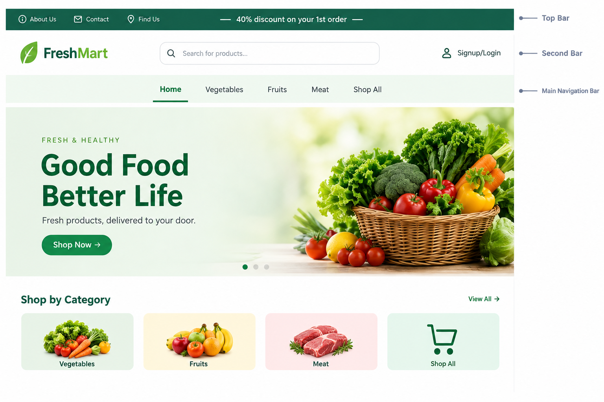
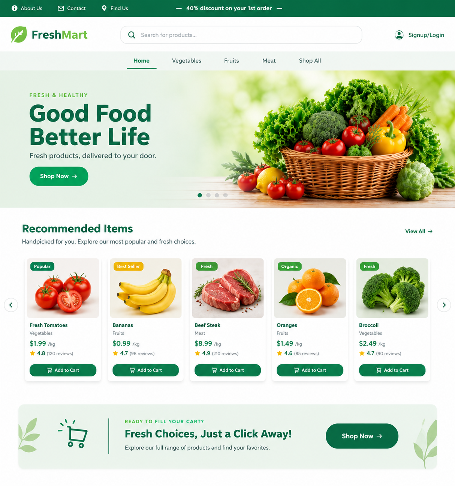
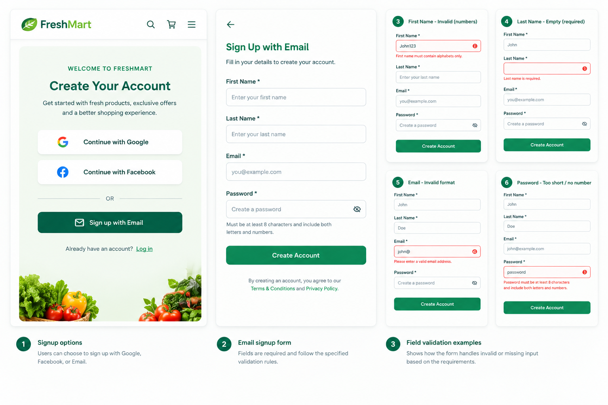
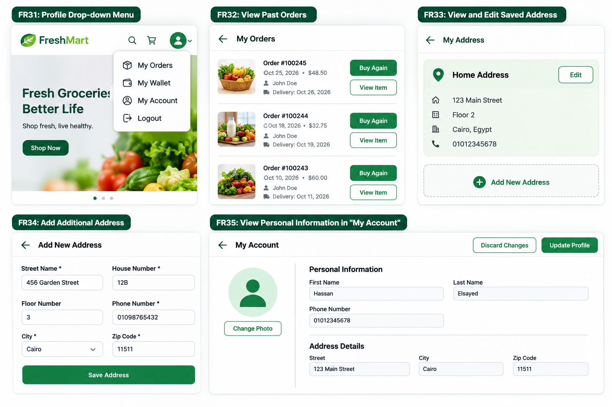
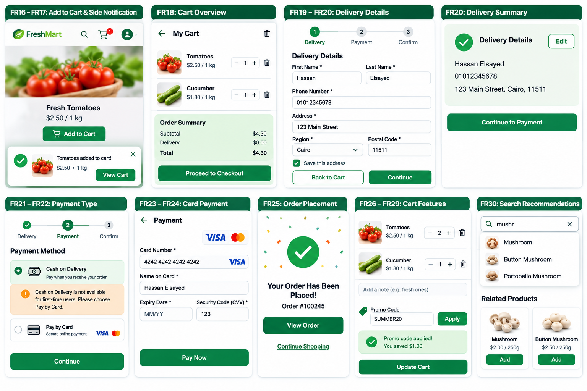

# Gazara

Test design for **Gazara**, a grocery store website (vegetables, fruits and meat) with a shopping cart, checkout and user accounts. I started from the functional requirements document, wrote test scenarios, and turned them into detailed test cases in Jira + Zephyr Scale.

## Summary

| | |
|---|---|
| Requirements analyzed | 35 functional requirements (FR1 to FR35) |
| Test scenarios | 98 across the 6 modules, tracked on a Trello board |
| Test cases written | 98 (66 positive, 32 negative) |
| Priority split | 57 High, 28 Normal, 13 Low |
| Modules | 6 (header, home, catalog, authentication, profile, cart & checkout) |
| Tools | Jira, Zephyr Scale, Trello, Excel |

## Modules and Coverage

| # | Module | Requirements | Positive | Negative | Total |
|---|--------|--------------|:--------:|:--------:|:-----:|
| 01 | Header & Navigation | FR1 to FR7, FR30 | 9 | 1 | 10 |
| 02 | Home Page | FR8, FR9 | 3 | 1 | 4 |
| 03 | Product Catalog | FR10 to FR13 | 11 | 0 | 11 |
| 04 | Authentication | FR14, FR15 | 10 | 14 | 24 |
| 05 | User Profile | FR31 to FR35 | 11 | 3 | 14 |
| 06 | Cart & Checkout | FR16 to FR29 | 22 | 13 | 35 |
| | **Total** | | **66** | **32** | **98** |

## What the Test Cases Cover

- **Layout and content:** top bar, promotional message, logo, search bar and main navigation, including the bold "Home" link
- **Navigation behavior:** "About Us" scroll, Contact form, Find Us window, search suggestions, "Shop Now" redirect
- **Sign-up validation:** required fields, alphabets-only names, email format, password rules (8+ characters, letters and numbers), sign-up with Google and Facebook
- **Access control:** guest users cannot add to cart, view the cart, pay, or open the cart and payment pages by direct URL
- **Profile:** orders list, "Buy Again", saved address (view, edit, add), personal information, logout
- **Cart and checkout:** add-to-cart pop-up, cart page and order summary, delivery details form, delivery summary with edit, payment type selection, card details and validation, placing an order, item quantity, removing items, item notes, promo codes

Each test case has a Key (`GAZ-T1` and so on), a title, preconditions, priority, step-by-step actions with expected results, and a folder (module / Positive or Negative).

## UI Mockups

These are illustrative screens that I used to visualize the requirements while writing test cases. They are not screenshots of a live application.

### Header & Navigation (FR1 to FR4)



### Home Page (FR8, FR9)



### Sign Up (FR15)



### Profile & Account (FR31 to FR35)



### Cart & Checkout (FR16 to FR30)



## Folder Structure

```
gazara/
├── README.md
├── requirements/
│   └── Gazara grocery store 🥕.md
├── test-scenarios/
│   └── gazara-test-scenarios.md
├── test-cases/
│   ├── 01-header-navigation-test-cases.xlsx
│   ├── 02-home-page-test-cases.xlsx
│   ├── 03-product-catalog-test-cases.xlsx
│   ├── 04-authentication-test-cases.xlsx
│   ├── 05-user-profile-test-cases.xlsx
│   └── 06-cart-checkout-test-cases.xlsx
└── mockups/
    ├── 01-home-page-header.png
    ├── 02-home-page-content.png
    ├── 03-signup-page.png
    ├── 04-profile-account.png
    └── 05-cart-checkout.png
```
